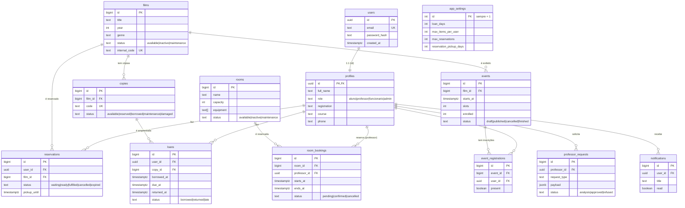

# DER — Videoteca UNIFOR (T02.1)

Modelo de dados do sistema. 13 entidades cobrindo autenticação/perfis, acervo
audiovisual, empréstimos, reserva de salas, eventos, solicitações de professores
e notificações.

## Diagrama entidade-relacionamento



## Regras de integridade

| Regra | Onde | Migration |
|-------|------|-----------|
| `profiles.id` = `users.id` (1:1), cascade no delete | FK | 001 |
| Domínios de `status` restritos por `CHECK` | 8 tabelas | 002 |
| `room_bookings.ends_at > starts_at` | CHECK | 002 |
| `rooms.capacity > 0`, `films.year ∈ [1888,2100]` | CHECK | 002 |
| `loans.returned_at >= borrowed_at` | CHECK | 002 |
| **Anticonflito**: nenhuma sala com 2 reservas não-canceladas em horários sobrepostos | `EXCLUDE USING gist` | 003 |
| Índices em todas as FKs e colunas de filtro (RNF01) | 23 índices `idx_*` | 002 |

## Convenções

- **PKs de usuários**: `uuid` (compatível com futura federação/OAuth — T03).
- **PKs de domínio**: `bigint` identidade.
- **Timestamps**: `timestamptz` (sempre com fuso).
- `app_settings`: linha única (`CHECK id = 1`) com parâmetros globais do sistema.

## Migrations e seed

```
db/
├── migrations/
│   ├── 001_init_schema.sql          # tabelas base
│   ├── 002_constraints_indexes.sql  # CHECKs, validações e índices
│   └── 003_anticonflict.sql         # EXCLUDE constraint (btree_gist)
├── seed/
│   └── seed_dev.sql                 # massa de teste (senha: videoteca123)
└── DER.md
```

Aplicação local: `docker compose up postgres` roda as 3 migrations + seed no boot.
Aplicação manual: rode os arquivos de `migrations/` em ordem; `seed/` é opcional (dev).
